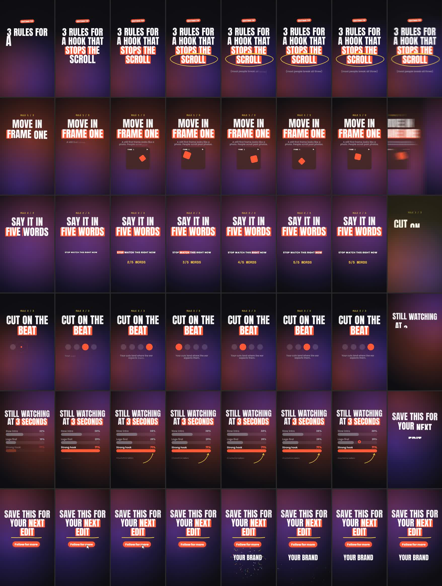

# Social Motion

**Motion graphics for Reels, TikTok and Shorts, written as code.** Give Claude a brief or a script and get
a frame-exact 9:16 MP4: kinetic typography, stat counters, animated charts, TikTok-style captions, cards, CTAs,
logo stings and transitions cut on the beat. The sound is synthesised from the same timeline as the picture.



Node + ffmpeg. No browser, no GPU, no API keys, no stock music or samples to license.

---

## How it works

- **A film is a pure function `frame(ctx, t)`.** `@napi-rs/canvas` draws each frame in Node, and the frames
  are piped into ffmpeg. There is no state between frames, so any frame can be previewed on its own and a
  re-render gives the same pixels.
- **Brand kit.** `brand.json` holds the colours, fonts and logo. Every component reads it, so changing
  client means editing one file.
- **Social grammar built in.** Platform safe zones, including the like/comment rail on the right, with a
  `--safe` preview overlay. A hook-first workflow, reading-time rules, and cuts on musical bars.
- **A harness that makes you look.** `sheet` renders a grid of keyframes and `strip` renders consecutive
  frames around a transition. `verify` checks for determinism, `SCALE=.5` gives a quick preview render,
  `still` exports the cover frame and `contact` makes a sheet of the encoded final.
- **Sound.** `beat.mjs` synthesises a music bed (hype, chill or corporate) at your tempo, with a drop, breaks
  and an ending that resolves on your logo. `sound.mjs` places 22 synthesised SFX on cue times, then
  loudness-normalises to −14 LUFS and muxes the audio onto the video.
- **Written know-how.** `references/` holds the polish bible, typography, motion, layout, style presets,
  sound and a traps table. Claude reads these while it builds.

## Make it yours: brand, style, fonts, images

- **Brand kits.** A `brand.json` sets colours, fonts, logo and the motion style (background, text
  entrance, highlight, transition, grain). Keep private client kits in `~/.social-motion/brands/<client>/`,
  with their fonts and logo next to the file. They work in every project and never go in this repo.
  `BRAND=<client> node film.mjs render` renders the same film in another kit. Two kits ship with the
  plugin: `hype` and `clean`.
- **Photos and b-roll.** `lib/media.mjs` covers full-bleed photos with Ken Burns, duotone into brand
  colours, grade and tint, transparent cut-outs with a sticker outline, and short video clips.
- Details are in `references/brand-and-assets.md`.

## Sound: voice-over, music, effects

```bash
node $SK/scripts/sound.mjs out/cues.json out/reel.mp4 out/final.mp4 --voice vo.mp3 --voice-at 0.4 --bed track.mp3
```
- Voice-over and music can be any format ffmpeg reads. The music ducks automatically while the voice talks
  and fades out if it runs longer than the video.
- Your own SFX files can be cues, next to the 22 synthesised ones.
- For captions from a voice-over, use `scripts/transcribe.py` (local faster-whisper) or an SRT export from
  CapCut or Premiere, then run `words.mjs`. `captions()` and `wordTime()` then place visuals on the spoken words.

## The example

`examples/hook-reel/` is a 24 s, 9:16 tip reel titled "3 rules for a hook". It has slam type with a
scribble, a demo card, a caption demo, a beat metronome, a bar chart, a CTA with a tap, and a logo sting.
It is cut on 124 bpm bars and has 36 sound cues.

```bash
cd plugins/social-motion/skills/social-motion && npm install && cd -
cd examples/hook-reel && ./make.sh          # -> out/hook-reel-final.mp4
```

## Install

From GitHub (after you push this repo):

```bash
claude plugin marketplace add <your-github-user>/social-motion-skill
claude plugin install social-motion@social-motion-skill
cd ~/.claude/plugins/…/skills/social-motion && npm install      # the path `claude plugin` reports
```

From a local folder:

```bash
claude plugin marketplace add ./social-motion-skill
claude plugin install social-motion@social-motion-skill
```

Or copy `plugins/social-motion/skills/social-motion/` to `~/.claude/skills/social-motion/` and run `npm install` there.

**Requirements:** node 20+, ffmpeg and ffprobe on PATH.

Then ask Claude Code something like *"bikin reels 15 detik buat promo kopi susu, brand kit di ./brand.json"*
or *"animate these 4 stats as a 9:16 reel, clean corporate style"*.

## What's inside

```
plugins/social-motion/skills/social-motion/
  SKILL.md                 hard rules + a "read first" router
  lib/core.mjs             easing, closed-form springs, life() envelopes, beat(), colour, canvas helpers
  lib/film.mjs             sheet / strip / still / verify / render / cues / contact, SCALE previews
  lib/brand.mjs            brand kits by path or name (colours, fonts, logo, motion style)
  lib/media.mjs            photos (Ken Burns, duotone, grade), cut-outs, b-roll clips
  brands/                  shipped kits: hype, clean
  lib/layout.mjs           formats, platform safe zones + rail, grid helpers
  lib/type.mjs             kinetic text (7 reveals, *emphasis*, exits, auto-fit), counters, captions
  lib/sequence.mjs         scenes on a timeline + 10 transitions, cut times for sound
  lib/components.mjs       tag, card, list, lower third, CTA with tap, logo sting, progress
  lib/charts.mjs           bars, columns, donut, line chart
  lib/shapes.mjs           draw-on arrows, checks, scribble circles, underlines, icons
  lib/fx.mjs               living backgrounds, grain, vignette, camera, punch, shake, particles
  scripts/sound.mjs        voice-over + music (any format, auto-ducking) + 22 synthesised SFX or your own files, loudnorm, mux
  scripts/words.mjs        word timings from Whisper JSON or SRT/VTT -> words.json for captions
  scripts/transcribe.py    local word-level transcription (faster-whisper)
  scripts/new-kit.mjs      start a private brand kit
  scripts/beat.mjs         synthesised music bed (hype / chill / corporate) + beat grid
  templates/               film-template.mjs, brief.md, brand.json
  references/              workflow, polish, typography, motion, layout, styles, sound, traps, prior-art
  assets/fonts/            Anton, Poppins, Space Mono (SIL OFL)
examples/hook-reel/        the 24 s example
```

## Credits

Built on the architecture of [buildwithhanif/claude-animation-skill](https://github.com/buildwithhanif/claude-animation-skill)
(MIT). The harness, stable seeds, sheet/strip/verify, synthesised sound and the "detail bible" approach
come from there. See `references/prior-art.md` and `LICENSE`.
